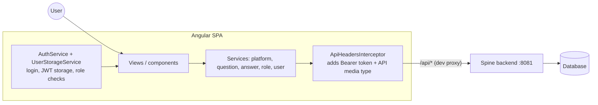

# Spine — Platform Risk Assessment (Frontend)

Angular web app for registering the digital platforms an organisation uses, answering a standard risk questionnaire per platform and tracking each platform's risk score.

[](https://github.com/DanielB-02/IPSEN3_frontend_angular/actions/workflows/ci.yml)

**Live demo:** [TODO: live demo link]
**Backend:** [TODO: link to the Spine backend repository]

[TODO: screenshot]
<!-- Suggested: the dashboard (Top 10 / Bottom 5 risk scores) in the dark theme, plus a short GIF of
     opening a platform, editing an answer and exporting the PDF. Save under docs/ and embed with
      -->


## What it does and why

Organisations use many third-party platforms and need an overview of which ones carry the most risk. Spine gives every platform the same questionnaire; the answers are stored by the backend, which calculates a risk score per platform. This frontend lets users browse and rank platforms by that score, fill in and edit answers, archive platforms they no longer use and export a platform's questionnaire to PDF. Access is role-based, so read-only users can view everything without being able to change it.

This was built as a team project of five students for the IPSEN3 course at Hogeschool Leiden. **My role:** [TODO: describe what you built, e.g. which screens/features].

## Key features

- **Dashboard** with the 10 highest- and 5 lowest-scoring platforms
- **Platform list and detail view** with the questionnaire answers per platform; answers can be edited inline
- **Duplicate detection** when adding a platform: exact names and close misspellings (string-similarity) are rejected
- **New platforms get the standard question set**, and admins can add a question to all platforms at once
- **Archive and restore** platforms
- **PDF export** of a platform's questions and answers (jsPDF)
- **Role-based UI** (`ADMIN`, `FICTER`, `READONLY`) driven by the roles in the JWT
- **Admin panel:** create users, delete users, create roles with permissions
- Dark theme

## Tech stack

| Area | Tools |
| --- | --- |
| Framework | Angular 17, TypeScript, RxJS |
| UI | Angular Material, SCSS |
| Auth | JWT (stored client-side, decoded with `jwt-decode`), HTTP interceptor for the `Authorization` header |
| Other libraries | jsPDF, string-similarity |
| Testing | Jasmine + Karma (unit), Cypress (end-to-end, backend stubbed) |
| Quality | ESLint (angular-eslint), Prettier, GitHub Actions |

## How it works



- `src/app/view` — one folder per screen (dashboard, platforms, platform detail, admin panel, …)
- `src/app/services` — thin HTTP services per backend resource; `PlatformService` keeps the platform list in a `BehaviorSubject` so lists refresh after an update
- `src/app/auth` — login/logout and role checks based on the JWT payload
- `src/app/conf/http-interceptor.ts` — adds the bearer token and the versioned media type (`application/vnd.spine.api.v2+json`) to every non-auth request

The UI hides actions based on the user's roles. Authorisation itself is enforced by the backend.

## Getting started

**Prerequisites:** Node.js 20 (see `.nvmrc`) and a running Spine backend on `http://localhost:8081` ([TODO: link to backend setup instructions]).

```bash
npm ci
npm start            # http://localhost:4200
```

During development, `proxy.conf.json` forwards `/api/*` to `http://localhost:8081`, so no environment variables or secrets are needed in the frontend. The base API path is set in `src/app/environments/environment.ts`.

**Production build:**

```bash
npx ng build                  # output in dist/spine-frontend-angular/browser
npm run build                 # same, then moves the files to _static/ for deployment (needs a POSIX shell)
```

## Tests

```bash
npm run test:ci      # unit tests, headless Chrome
npm test             # unit tests in watch mode

npm start            # in one terminal
npm run e2e          # in another: Cypress end-to-end tests (all backend calls are stubbed)

npm run lint         # ESLint
npm run format:check # Prettier
```

The unit tests cover login and token storage, JWT role checks, the API header interceptor, `PlatformService`, duplicate-name detection, the active/archived filters and the PDF export. GitHub Actions runs lint, formatting, unit tests, the production build and the Cypress suite on every push and pull request.

## What I learned / next steps

**What I learned:** [TODO: 2–3 honest bullets, e.g. what you learned about Angular, JWT auth or working in a Scrum team of five]

**Next steps:**
- Add route guards so unauthenticated users are redirected before a protected page loads
- Upgrade from Angular 17 (end of life) to a supported version and enable TypeScript `strict` mode
- Use English names throughout the codebase (e.g. `archief` → `archive`)
